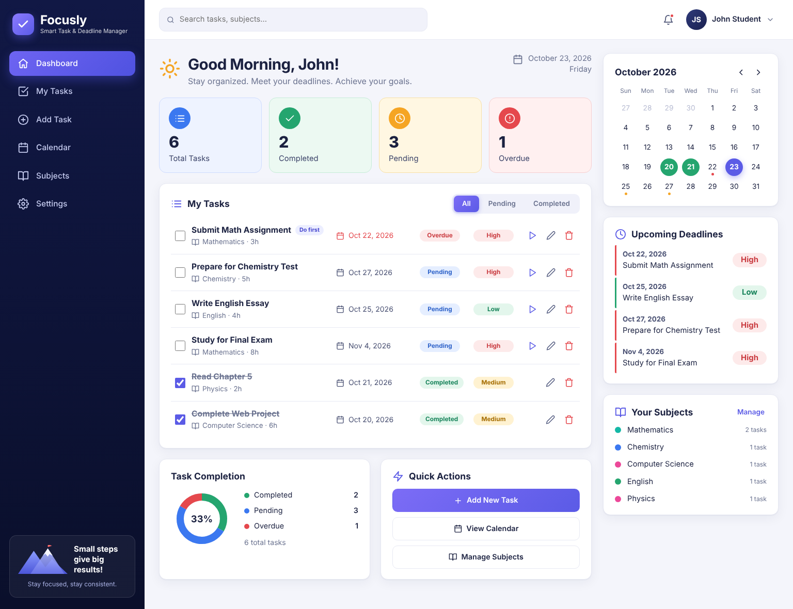
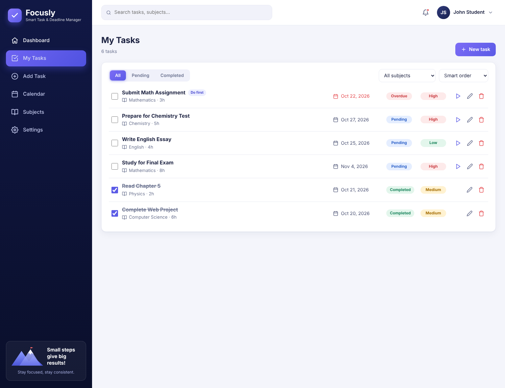
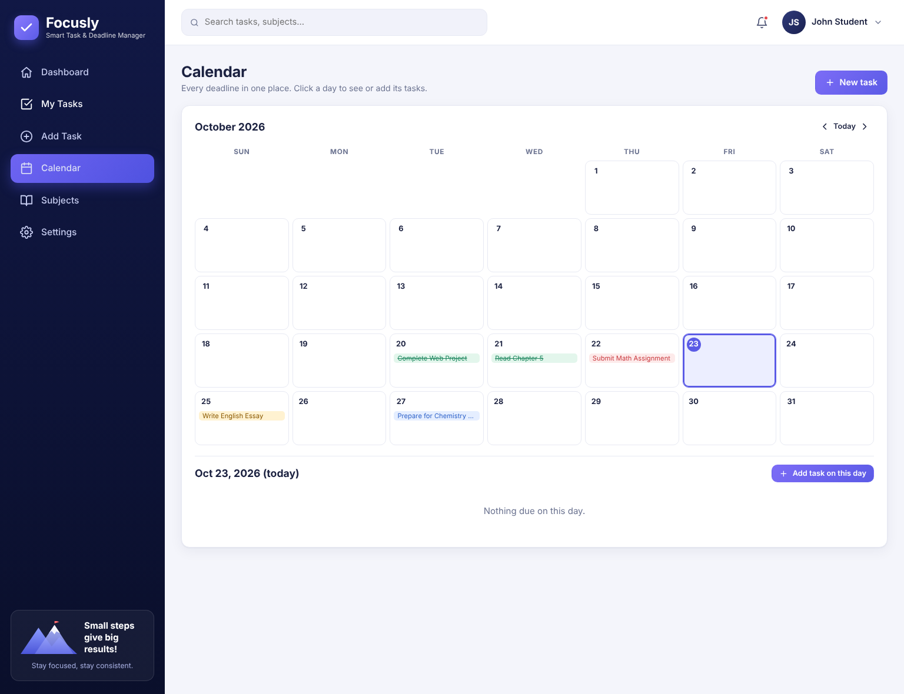
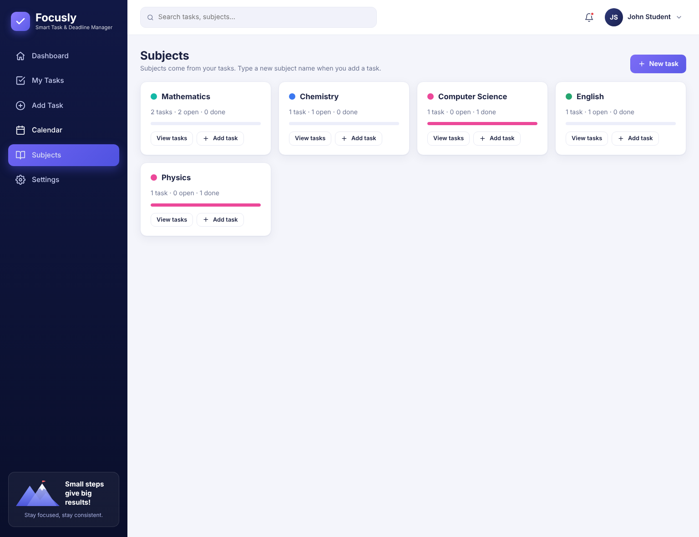
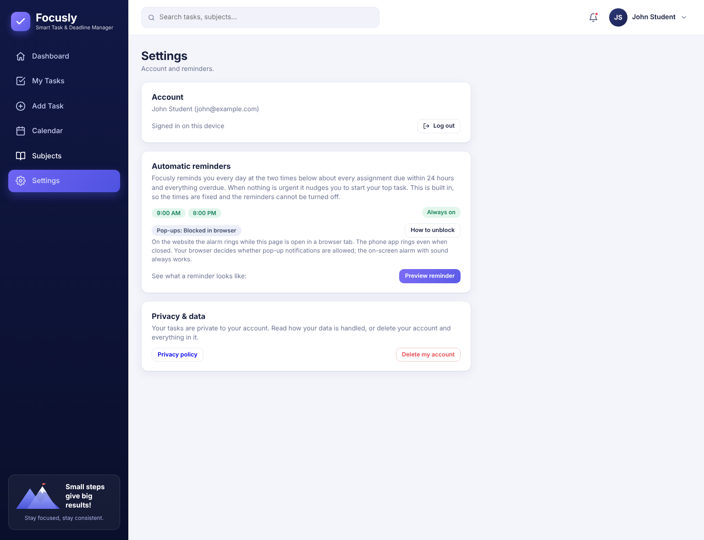
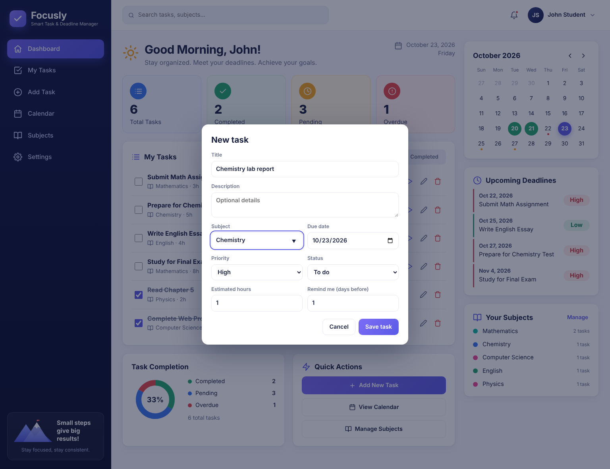
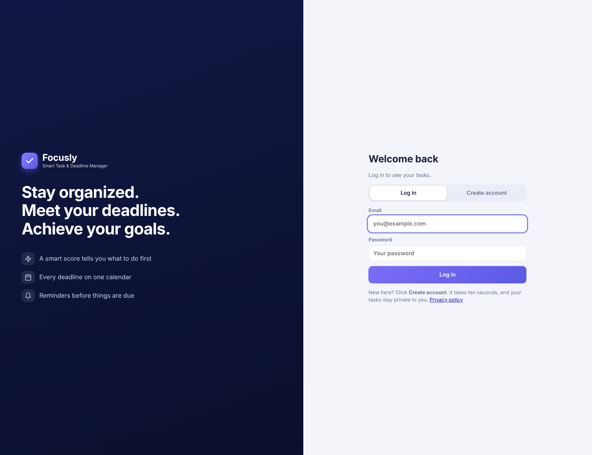
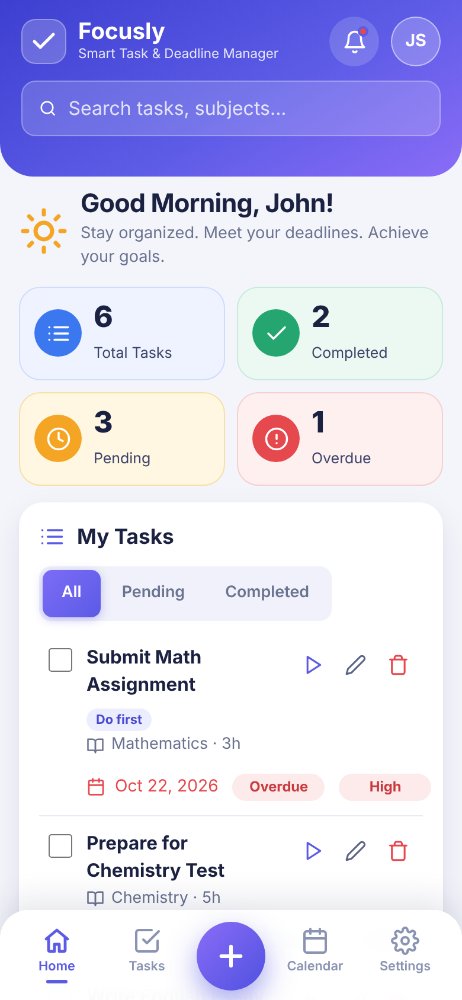

# Focusly: Smart Task & Deadline Manager

**One frustration, fixed:** students juggle assignments from many subjects, forget deadlines, and never know *what to work on first*.
Focusly keeps every task and deadline in one place, ranks them with a smart priority score, warns about what is overdue or
due soon, and shows it all on a calendar.

> **Java is the brain** (Spring Boot: rules, scoring, accounts, data, REST API) · **JavaScript is the face** (HTML/CSS/JS: dashboard, tasks, calendar, notifications) · The two talk through a JSON REST API.

## Screenshots

| Dashboard | My Tasks |
|---|---|
|  |  |
| **Calendar** | **Subjects** |
|  |  |
| **Settings** | **New task form** |
|  |  |
| **Login** | **Phone layout** |
|  |  |

*(Replace these with screenshots of your own running app before you submit.)*

## Features

- **Accounts:** register and log in; each student sees only their own tasks. Passwords are stored as BCrypt hashes.
- **Dashboard:** greeting, four stat cards (total, completed, pending, overdue), task list with All / Pending / Completed tabs, mini calendar, upcoming deadlines, subjects, completion donut and quick actions.
- **Smart priority score:** the top open task is tagged "Do first" (deadline + priority + effort).
- **Tasks:** add, edit, delete, start, complete. Subject, due date, priority, estimated hours, reminder window.
- **My Tasks page:** search, filter by status and subject, four sort orders.
- **Calendar page:** month grid with colour-coded deadlines; click a day to see or add its tasks.
- **Subjects page:** every subject with its progress; click one to see its tasks.
- **Automatic reminders (built in, fixed, always on):** every day at 9:00 AM and 8:00 PM an alarm (banner + sound + vibration, plus a pop-up if allowed) reminds you of assignments due within 24 hours and anything overdue, or nudges you to start your top task. Snooze button, bell menu.
- **Friendly errors:** loading bar, clear error messages with a "Try again" button, form validation in the browser *and* on the server.
- **Phone apps:** Android and iOS projects in `mobile/` (Capacitor) with native alarms, icons and splash screen. See [`docs/MOBILE_APP_GUIDE.md`](docs/MOBILE_APP_GUIDE.md).
- **Privacy:** privacy policy page and in-app *Delete my account* (required by the app stores).
- **Responsive:** sidebar becomes a slide-in menu on phones.
- **Data is saved** in a file database (survives restarts); PostgreSQL / MySQL are supported too.

## How it works

```
 Browser (HTML + CSS + JavaScript)                Java (Spring Boot)                       Database
 ┌───────────────────────────────┐   fetch()     ┌─────────────────────────────┐   JPA    ┌───────────┐
 │ forms · list · calendar ·     │ ───JSON────▶  │ Controller → Service        │ ───────▶ │ H2 file / │
 │ search · notifications        │ ◀──JSON────   │   TaskValidator, SmartScorer│ ◀─────── │ PostgreSQL│
 └───────────────────────────────┘  (REST API)   │ Repository · AuthInterceptor│          │ / MySQL   │
                                                  └─────────────────────────────┘          └───────────┘
```

### The Java classes

| Package | Class | What it does |
|---|---|---|
| `model` | `BaseEntity` *(abstract)* | Shared `id` + `createdAt`; **inherited** by `Task` and `User` |
| `model` | `Task`, `User`, `AuthToken` | Database entities with private fields (**encapsulation**) |
| `model` | `Priority`, `Status` | Enums |
| `service` | `ScoringStrategy` *(interface)* → `SmartScorer` | The priority rule can be swapped without touching other code |
| `service` | `TaskService` | Task logic: CRUD (scoped per user), sorting/filtering with `List`, `Map`, `Comparator`, stats |
| `service` | `TaskValidator` | Rejects wrong or missing input with clear messages |
| `service` | `AuthService` | Accounts (password at least 8 characters, BCrypt) and login tokens |
| `exception` | `ApiException` *(abstract)* → `InvalidInputException`, `NotFoundException`, `UnauthorizedException`, `ConflictException`, `ServiceUnavailableException`, `BadGatewayException` | Every error carries its own HTTP status |
| `controller` | `TaskController`, `AuthController`, `NotificationController`, `ApiExceptionHandler` | REST endpoints and JSON error messages |
| `repository` | `TaskRepository`, `UserRepository`, `AuthTokenRepository` | Database access |
| `config` | `AuthInterceptor`, `WebConfig`, `SecurityBeans` | Login check on every API call; password hashing |
| `util` | `TokenHasher` | SHA-256 for stored login tokens |

### The smart score

`score = urgency (0-60) + priority (6 / 18 / 30) + effort (0-10) + 3 if already started`

Overdue tasks always get full urgency; urgency fades as the deadline gets far away; effort counts less when the deadline is far.
Finished tasks score 0. The rule lives in `SmartScorer`.

## How to run

You need **Java 17+** and **Maven 3.8+**. Open a terminal in the folder that contains `pom.xml`.

```bash
mvn spring-boot:run
```

Open **http://localhost:8080**, click **Create account**, then **Add sample tasks** if you want something to look at.
Data is saved in the `data/` folder (delete it to start fresh). Stop with `Ctrl + C`.

### Run the unit tests

```bash
mvn test
```

There are **24 JUnit 5 tests** (`src/test/java`): the scoring rule, deadline/urgency labels, input validation, token hashing and the error classes.

### Other databases

| Database | Command |
|---|---|
| H2 file (default, nothing to install) | `mvn spring-boot:run` |
| In-memory (wiped on every stop) | `mvn spring-boot:run -Dspring-boot.run.profiles=dev` |
| PostgreSQL | `createdb taskmanager`, set `DB_USER` and `DB_PASSWORD`, then `mvn spring-boot:run -Dspring-boot.run.profiles=postgres` |
| MySQL | set `DB_USER` and `DB_PASSWORD`, then `mvn spring-boot:run -Dspring-boot.run.profiles=mysql` |

Set variables with `set DB_USER=...` (Windows) or `export DB_USER=...` (Mac/Linux). SQL scripts are in `database/`.

### Docker (bonus)

```bash
docker compose up --build                                   # app + file database, then open http://localhost:8080
docker compose -f docker-compose.postgres.yml up --build    # app + PostgreSQL (needs .env, see .env.example)
```

### Secrets

**No passwords or keys are written in the code.** Database logins are read from environment variables.
Copy `.env.example` to `.env` (git-ignored) when you need them.

### Browser notifications

Reminders are **automatic and cannot be changed or turned off**: every day at **9:00 AM** and **8:00 PM** Focusly reminds you about assignments due within 24 hours and anything overdue (or nudges you to start your top task). **Settings → Automatic reminders** shows the times and has a **Preview reminder** button. Allow the browser's pop-up prompt for notifications outside the page. The page must stay open (a background tab is fine). Pop-ups need `localhost` or `https`; on a plain `http://192.168...` address only the on-screen alarm works. The phone apps schedule the same two times with the phone's own alarm, so they ring even when the app is closed.

### Deploying (bonus)

**Easiest:** follow [`docs/DEPLOY_WEBSITE.md`](docs/DEPLOY_WEBSITE.md); `render.yaml` creates the site and the database in one click. Details below.


The app reads the `PORT` environment variable, so it runs on hosts like Render or Railway as a Docker service. On those hosts the local
file is wiped on redeploy, so use their PostgreSQL: set `SPRING_PROFILES_ACTIVE=postgres`, `DB_URL`, `DB_USER`, `DB_PASSWORD` as environment variables.
The front end is served by the same app, so no separate hosting is needed.

## REST API

All endpoints except `register` and `login` need the header `Authorization: Bearer <token>`.
Errors come back as JSON: `{"message": "..."}` with a sensible status (400 bad input, 401 not logged in, 404 not found, 409 conflict).

| Method | Endpoint | Description |
|---|---|---|
| POST | `/api/auth/register` | `{"name","email","password"}` → `{token, user}` |
| POST | `/api/auth/login` | `{"email","password"}` → `{token, user}` |
| POST | `/api/auth/logout` | End the session |
| GET | `/api/auth/me` | Current user |
| DELETE | `/api/auth/me` | `{"password"}` : permanently delete your account and tasks |
| **POST** | `/api/tasks` | **Create** a task |
| **GET** | `/api/tasks?status=&subject=&sort=smart\|due\|priority\|title` | **Read** your tasks |
| **GET** | `/api/tasks/{id}` | **Read** one task |
| **PUT** | `/api/tasks/{id}` | **Update** a task |
| PATCH | `/api/tasks/{id}/status` | `{"status":"TODO\|IN_PROGRESS\|DONE"}` |
| **DELETE** | `/api/tasks/{id}` | **Delete** a task |
| POST | `/api/tasks/samples` | Add a few example tasks |
| GET | `/api/focus?limit=3` | Top-priority open tasks |
| GET | `/api/reminders` | Overdue and due-soon tasks |
| GET | `/api/stats` | Dashboard numbers |
| GET | `/api/subjects` | Your subjects |

Example:
```bash
curl -X POST localhost:8080/api/auth/register -H 'Content-Type: application/json' \
  -d '{"name":"Aarav","email":"aarav@example.com","password":"secret123"}'
# use the returned token:
curl -X POST localhost:8080/api/tasks -H 'Authorization: Bearer <token>' -H 'Content-Type: application/json' \
  -d '{"title":"Essay","dueDate":"2026-10-20","priority":"HIGH","estimatedHours":4}'
```

## Security notes

- Passwords: BCrypt hashes only. Login tokens: only a SHA-256 fingerprint is stored; tokens expire after 30 days.
- Every task query is filtered by the logged-in user's id, so one student can never read or change another's tasks.
- User text is escaped before it is drawn on the page (no HTML injection).
- For a public deployment use HTTPS.

## Project layout

```
src/main/java/com/studentapp/taskmanager/   config · controller · dto · exception · model · repository · service · util
src/main/resources/static/                  index.html · css/style.css · js/app.js
src/main/resources/application*.properties  settings (secrets come from environment variables)
src/test/java/...                           JUnit tests
database/                                   SQL schemas (PostgreSQL, MySQL)
docs/                                       screenshots, user testing, AI declaration, framework notes, checklist
mobile/                                     Android + iOS apps (Capacitor)
Dockerfile · docker-compose*.yml            Docker (bonus)
```

## Project documents

- [`docs/CHECKLIST.md`](docs/CHECKLIST.md): every requirement of the brief and where it is met
- [`docs/USER_TESTING.md`](docs/USER_TESTING.md): real-user test sheet (compulsory)
- [`docs/AI_USE_DECLARATION.md`](docs/AI_USE_DECLARATION.md): AI use declaration table
- [`docs/FRAMEWORK_NOTES.md`](docs/FRAMEWORK_NOTES.md): what Spring Boot does for me (for the video)
- [`docs/DEPLOY_WEBSITE.md`](docs/DEPLOY_WEBSITE.md): publish the live website (one-click Render blueprint)
- [`docs/MOBILE_APP_GUIDE.md`](docs/MOBILE_APP_GUIDE.md): publish on Google Play and the App Store
- [`docs/COMMIT_PLAN.md`](docs/COMMIT_PLAN.md): how to keep an honest commit history
